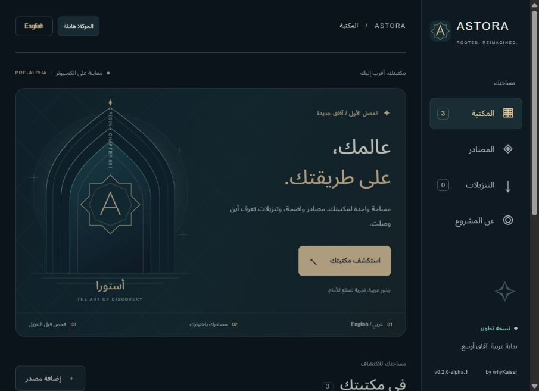

# ASTORA

**عالمك، على طريقتك.** An Arabic/English library project, starting with PS4 package workflows.

[العربية](README.ar.md) · [Catalog format](docs/catalog-format.md) · [Roadmap](docs/roadmap.md) · [Verification](docs/verification.md) · [Standalone research](docs/standalone-research.md) · [Design](docs/design.md)



[English interface preview](docs/preview-en.jpg) · [Library preview](docs/library.jpg)

## Status: desktop pre-alpha

**v0.2.0-alpha.1 is a working desktop preview and package-management foundation. It is not a standalone PS4 application. There is no ASTORA PKG release yet.** Downloads in this version are saved on the computer, not installed on a console.

The intended product runs on PS4 without a PC. That requires a native runtime and console testing; neither is claimed complete here. PS3 and PS5 games do not become playable on PS4 by adding a catalog.

## What works

- Arabic and English, mirrored RTL/LTR layout, saved language and reduced-motion settings.
- Original ink/teal/champagne identity with Arabic-inspired SVG geometry.
- Indexed bilingual search, 24-card pagination, platform filters and keyboard navigation. Tested with a 5000-entry catalog.
- Multiple named catalogs and multiple download mirrors per item. JSON file or public URL import.
- Real HTTP preflight: follow redirects, read the first 8 KiB, identify HTML, archives, zero-filled responses, and PS4 PKG headers.
- Compare the package title ID, content kind and declared size with catalog metadata.
- Explain access restrictions, missing files, rate limits and invalid responses with stable error codes and Arabic/English messages.
- Download one file at a time to `data/downloads/`; pause and recover after restart. Resume requires HTTP Range and an unchanged strong ETag. No unsafe append when a source changes.
- Compute SHA-256 on complete files and compare a published checksum when provided. A file with a mismatched hash remains unapproved as `.part`.
- Keep transfer and installation states distinct. This preview never reports a console installation.

The bundled catalog links to three free homebrew tools on their developers' GitHub releases. No game files, private catalogs, credentials or signed download URLs are distributed with this project.

## Run

Requires Node.js 22 or newer. No third-party npm dependencies or install step.

```sh
git clone https://github.com/whyKaiser/ASTORA.git
cd ASTORA
npm start
```

Open **http://127.0.0.1:4318**. On Windows, `Start-ASTORA.cmd` starts the same local server. Keep that terminal running while using this development preview.

```sh
npm test
npm run check
```

Automated GitHub Actions are not enabled yet. [A workflow template](docs/github-actions.example.yml) is included for Node.js 22 and 24; activating it requires repository workflow write access. Local tests are runnable immediately.

## Try it

1. Open a bundled app, such as **PS4 Games Installer**.
2. Select **فحص المصادر** (inspect sources). The result describes the actual response, not the filename alone.
3. Select **تنزيل على الكمبيوتر** (download to computer).
4. Watch the Downloads page. Only a complete file that passes the configured verification becomes **اكتمل التنزيل على الكمبيوتر**.
5. Find the file under `data/downloads/<job-id>.pkg`. The application title and hash remain in download history.

## Current limits

- No PS4-native executable, console installation API, PS5 support, controller testing or firmware compatibility claim yet.
- Catalog categories are organizational. PS1/PS2/PSP entries can be inspected only when already packaged in a PS4 container; this app does not convert or emulate them.
- Direct public HTTP(S) URLs only. Landing-page resolvers, login-required sources, archive extraction and debrid services are not implemented.
- HTTPS certificate validation stays enabled. HTTPS-to-HTTP redirects are rejected. An explicitly supplied HTTP source is labeled unencrypted.
- Public sources only: private/LAN addresses are blocked in this preview, including redirect targets. The development server binds to loopback and must not be exposed as a public service.
- Checking a header is not a signature/authenticity or compatibility check. A matching hash proves agreement with the supplied reference, not that the package is safe or licensed.
- Catalogs live in browser storage. Download metadata, including the original source URLs, lives locally in `data/downloads/jobs.json`; do not share that file if your URLs contain secrets.
- A failed download is not automatically retried against another mirror. Choose another source explicitly. Resume is refused if continuity cannot be established.

## Architecture and attribution

`src/` contains original JavaScript modules for catalogs, PS4 header inspection, bounded networking, diagnostics and download recovery. `server.mjs` is the development adapter. `web/` contains the original UI. See [the architecture](docs/architecture.md) for the native work remaining.

Original ASTORA code: MIT. Noto Sans Arabic: SIL Open Font License, included under [third-party/](third-party/Noto-OFL.txt). Linked homebrew tools retain their own authorship and licenses. ASTORA does not include NovaStore or DiPlay source, catalogs or binaries.

Maintained by [whyKaiser](https://github.com/whyKaiser). Not affiliated with Sony or PlayStation.
