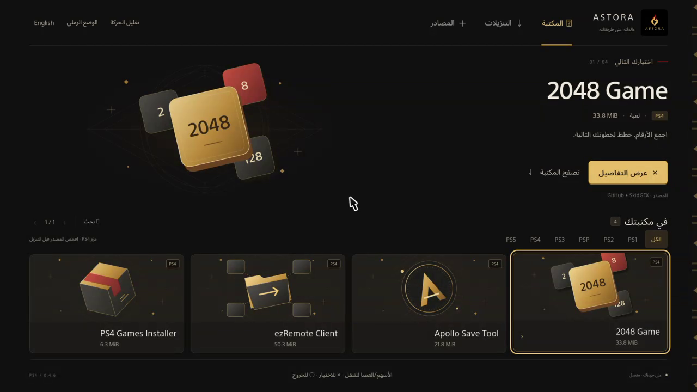
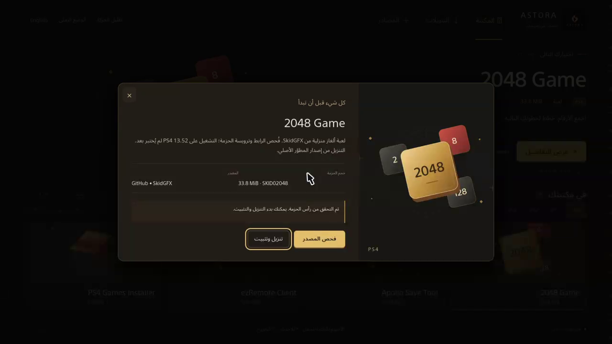
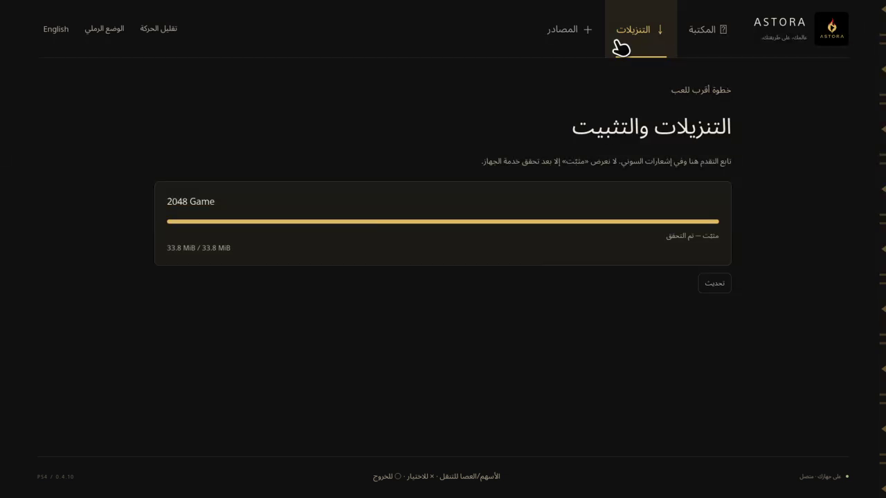
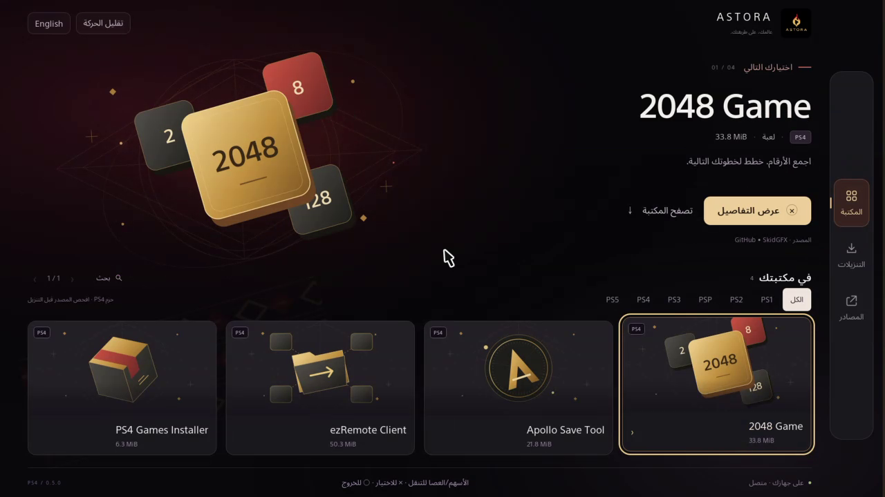

# Verification record

Date: 2026-10-18. Desktop environment: Windows. The 0.2.0-alpha.1 baseline passed **35 checks, 0 failed** on both **Node.js 25.6.0** and **Node.js 22.23.3**. Version-specific verification follows below; 0.3.0-alpha.1 was rerun on Node.js 25.6.0.

## Automated

`node --test test/*.test.mjs` covers catalog validation, signed-query preservation, content classification, title/type/size mismatches, local-network rejection, source diagnostics, real local HTTP redirects, pause/restart/resume, changed ETags, missing validators, SHA-256 mismatch, duplicate active-job rejection, and the loopback API boundary. Run the command for the authoritative current count and results.

`npm run check` checks syntax in the server and browser entry points.

The synthetic fixtures are not installable PS4 applications. They test parser/transfer behavior only. GitHub Actions is not enabled: the publishing connection lacks the `workflow` scope. A workflow template is provided in `docs/github-actions.example.yml`; its tests do not use live external package sources.

## Live transfer through the UI

Source: [PS4 Games Installer r34, developer release](https://github.com/e1z0/PS4-Games-Installer/releases/tag/r34).

- Selected through the Arabic library UI.
- Followed the GitHub redirect over HTTPS.
- Header title ID: `PGIN00001`.
- Download completed: **6,619,136 bytes**.
- Full-file SHA-256 matched the developer release asset digest:

```text
48998dff70bd06cd686880d830627cf80892520e4b0a93b3de81534d9999cc55
```

This proves a real desktop transfer through ASTORA for this specific asset at this time. It does not prove every source, PS4 compatibility or a console installation.

An additional opt-in live header check passed for all three bundled sources: Apollo Save Tool 2.4.0 (`APOL00004`), ezRemote Client 2.07 (`RMTC00001`) and PS4 Games Installer r34 (`PGIN00001`). Run `npm run test:live` to repeat that check against the current external sources.

## Not yet verified

- PC-off native operation and broad PS4 compatibility; any ASTORA execution on PS5.
- Full-file native hash verification and additional package/game compatibility.
- Suspend/resume, power interruption and extended controller acceptance.
- Arbitrary source resolvers; GitHub native HTTPS was verified below.
- Private, restricted or commercial-game sources.

## Browser checks

The local preview was exercised through its actual browser controls: search, empty platform filter, reset, source JSON file import, source disable, persistence after reload, source removal, package preflight and the completed transfer above. Arabic text and the layout were visually checked at the default desktop viewport and at a narrow mobile breakpoint. The narrow view had no horizontal document overflow. This is browser evidence, not PS4 controller evidence.

## 0.2.0-alpha.1 verification

The 35-check suite additionally verifies every static UI translation key, all backend diagnostic codes in English, translation validation/fallback, Arabic search normalization and complete 5000-entry pagination without duplicates or gaps. Both Node.js versions passed.

Actual UI checks: switch Arabic/English and reload; reduced motion persists; invalid catalog reports an English error; import a 5000-entry synthetic catalog; observe 5003 total entries with exactly 24 rendered cards and 209 pages; advance to page 2; search for the last entry; remove the synthetic catalog. Fixture URLs are non-downloadable example.org placeholders and were never opened.

RTL ArrowLeft moves focus from the first card to the next visually left card. The previously completed official-homebrew desktop transfer remains visible with matching hash and English download state. Arabic and English layouts were inspected at the default desktop viewport and a 390×844 viewport override (375 CSS pixels of content excluding the scrollbar); neither language had horizontal overflow. Viewport restored after testing. Browser logs reported no warning/error entries.

This release did not perform another console installation or a console frame-rate measurement. The standalone native acceptance gate remains open.

A live preflight through the 0.2 UI again identified PS4 Games Installer r34 as PGIN00001 over HTTPS with resume prerequisites. Closing the result dialog restored keyboard focus to its library card. No duplicate full-file download was started.

## 0.3.0-alpha.1 identity and appearance verification

- All 35 regression checks passed on Node.js 25.6.0. Syntax checks include the new early-theme script.
- The source and copied logo have identical SHA-256: `496aed3a014780681de3605493672c7ec409dd4d726880a938338156233eba2b`. Original dimensions remain 690 × 678.
- Actual browser switching confirmed dark and sand themes. Sand persists across reload, with computed body background `rgb(234, 217, 184)` and a successfully decoded original logo.
- Arabic and English layouts, the opening-preview dialog, library cards and narrow 390 × 844 viewport were inspected. Both measured content/scroll widths at 375 CSS pixels, without horizontal overflow. Viewport restored after testing.
- Native PS4 icon export/package integration was not performed. No console changes were made by this update.
- Final browser logs contained no warning/error entries.


## Native 0.4.0-alpha.1 preparation (not console acceptance)

- All 35 desktop regression checks still pass. Syntax checks pass for native ES5 UI and preview server.
- OpenOrbis 0.5.4 cross-compilation with clang18/ld.lld18 and `-Wall -Wextra -Werror` passed.
- Actual native HTTP server: 22 host tests pass with an explicit backend double, covering framing, Host/Origin/token validation, strict JSON, package metadata, traversal, persisted task validation and honest progress.
- Native backend contract tests pass, including UBSan trap mode: URL/DNS/TLS/redirect bounds, package identity, registration errors and progress. They do not execute console APIs.
- Browser adapter lifecycle mock tests pass; exact 328-byte ABI is guarded by compile-time assertions.
- Browser-only native UI checks: Arabic/English, dark/sand, persistence after reload, 2048 search and package details. Preview is visibly labeled as not connected to a console.
- A package was built as `IV0000-ASTR00001_00-ASTORA0000000000`, app version `00.40`, 6,619,136 bytes. Header title/type/size validated. Extracted inner-PFS assets, executable and runtime modules matched input SHA-256; metadata/icon were prepared separately.
- USB upload completed and complete FTP readback SHA-256 matched:

```text
cd97d904baee16d97962262e77a9c3bc45a10ca357a42d3d96670a437c1c9a43
```

The native BGFT implementation does not calculate full-file SHA-256.

### Console launch report — 2026-10-18

After being asked to install the staged `ASTORA-0.4.0-alpha.1-PS4.pkg` and open
ASTORA from the home screen, the tester reported: **“ظهرت واجهة أستورا”**
(the ASTORA interface appeared). This is user-reported evidence of interface
launch on the test PS4, whose previously reported firmware is 13.52.

Follow-up FTP reads timed out, so no native startup log or job record was collected
for this launch. Source inspection, native TLS, transfer progress, game installation,
gameplay, detailed Arabic/controller checks and PC-off operation remain unverified.
The next requested device check is **2048 Game → Check source → Download and install**.
Build success, desktop rendering and host tests do not satisfy these remaining checks.

## Native 0.4.1-alpha.1 TV interface and lifecycle

- Native cross-compilation passed with `-Wall -Wextra -Werror`.
- Eight UI model tests passed, including 5000-entry pagination with four rendered
  items per page, Arabic search normalization, filters, and geometric navigation.
- The actual HTTP server passed 23 host tests with a backend double. UI events
  require the session token, accept a fixed event allowlist, and stop after 64
  events per session. Arbitrary text, URLs and account IDs are not UI log fields.
- Browser lifecycle mock tests passed, including the new active-state accessor.
- Browser checks covered 1920×1080 and 1280×720 layouts, RTL navigation, detail
  opening, focus trapping/restoration, Arabic/English and dark/sand switching,
  reduced-motion persistence, the empty PS5 filter, and visible preview-only
  request errors. The 1280×720 document had no horizontal or vertical overflow.
  No browser warning/error entries were captured. Viewport override was reset.
- The package uses APP_VER/VERSION `00.41`. All 23 extracted inner-PFS files
  matched their input hashes. A complete USB FTP readback matched SHA-256:

```text
b1fcd0fec4f7a0e695e7f74ee59a09fc04365e76a3c66b8c7413822697765e84
```

The user confirmed **“ثبّتّه وفتح”** (installed it and it opened). Retrieved console
logs recorded `astora_boot_0.4.1`, successful backend/listener/browser startup,
`ui_library_ready`, and one browser close followed by
`interface_closed_exit_requested` before another successful launch.

The code previously kept its main loop alive after the browser dialog finished.
It now requests normal application exit. This is a verified code defect and
an observed exit sequence, but not proof of the cause of the user's earlier
black screen after selecting 2048. Console source inspection, native download,
installation, gameplay, measured frame rate and PC-off operation remain open.


## Native controller and HTTPS verification — 2026-10-18

Direct Remote Play captures from the actual PS4 13.52, not desktop previews:





- A zero browser-control mask in 0.4.2 disabled input. Restoring the custom
  browser controls restored pointer operation. Package ATTRIBUTE bit 5 follows
  the console's confirm-button assignment, preventing Cross from cancelling.
- In 0.4.5 and 0.4.6, Cross opened the focused 2048 card with the pointer elsewhere.
  D-pad Down selected Check source, and Cross activated it. The adapter then
  checked the SKID02048 package header and 33.8 MiB size over native HTTPS.
- The directional bridge prevents pointer clicks from overriding D-pad selection.
  Real stick movement returns to pointer targeting. Six input tests and eight
  model tests passed; backend contract, 23 HTTP-server tests and browser lifecycle
  tests also passed during this iteration. These host tests are not device tests.
- Resolver retry zero was rejected by the console HTTP library. Retry one, a
  non-null empty proxy hostname and operation-specific diagnostics restored the
  inspected GitHub source flow without disabling TLS verification.
- Native installation failed loading AppInstUtil: module load `0x80020002`,
  Sysmodule load `0x80020008`. Loading BGFT through Sysmodule succeeded.
  A ShellCore SELF identity experiment in 0.4.6 did not fix AppInstUtil; 0.4.7
  restored the original identity and loaded both explicit service dependencies
  successfully, but AppInstUtil still failed. 0.4.7 was installed and its first
  launch, directional card selection and HTTPS source inspection succeeded.
- One first launch after replacing 0.4.5 showed `CE-34878-0`; relaunch succeeded.
  After explicitly closing ASTORA before replacement, 0.4.6 launched first try.
  The intermittent failure is not yet attributed or claimed fixed.
- The binaries remain local test builds. No game download/installation or PC-off
  result is inferred from successful package inspection.

Build 0.4.8 removes AppInstUtil as a prerequisite for BGFT submission. The optional
precheck still runs where available, and BGFT's installed-title conflict is always
rejected. New backend contract checks cover absent/failed AppInstUtil, real progress
without confirmation, and a rejected conflict with no start or retry. They passed
with undefined-behavior sanitization. Native cross-compilation also passed.
On the actual console, 0.4.8 launched and inspected 2048 successfully. BGFT initialization then failed with `0x80990050` before task registration. No game download started.

Build 0.4.9 adds an external, checksum-pinned libjbc dependency for process credential setup before installer services load. Original credentials are retained and restored on normal app exit, with rollback after a partially failed setup. Host tests cover read/preparation/apply failures, failed restoration, retry behavior and successful idempotent setup/restore. They passed under UBSan alongside the backend contracts; the native build passed. On PS4 13.52, 0.4.9 launched, inspected the package and passed BGFT initialization. Registration then returned `0x80990033`. This isolates the next failure to URL handling rather than service setup.

Build 0.4.10 wraps the inspected source in the console-only BGFT reference format. Host tests verified header-digest/size fields, preservation and JSON escaping of the signed URL, GET/HEAD behavior, unavailable routes and rejected methods. Native compilation and backend tests passed.

## Native 0.4.10 actual download, installation and gameplay

On the same PS4 13.52, with its existing GoldHEN session:

- Package `00.50` installed and opened. Complete USB FTP readback matched SHA-256
  `1453cb047b1262a35597e4b04597b4058d514f561738aa85ec98b3735d066006`.
- The controller opened 2048 details and checked the developer's HTTPS package:
  `SKID02048`, 35,454,976 bytes (33.8 MiB).
- BGFT accepted ASTORA's loopback reference document. Actual displayed progress
  advanced through 3.8, 23.5 and 29.5 MiB to 33.8 MiB. The final label was
  **Installed — verified**, requiring BGFT completion and AppInstUtil confirmation.
- Exiting ASTORA returned normally to the PS4 home screen. Game 2048 appeared,
  launched, entered gameplay, and responded to D-pad tile movement.
- **Pressing Square on 2048's own Quit action produced `CE-34878-0` for Game 2048.**
  The error was dismissed and the console remained usable. Cause is unconfirmed;
  this is not a claim that the game is stable in all scenarios.
- ASTORA reopened normally, and its Transfers page retained the verified installed
  record. English/Arabic and sand/dark switching worked on the actual device.
  Arabic and dark mode were restored before exiting.
- Both normal ASTORA exits logged `privileges_restore 0x00000000`.



[English on PS4](ps4-english-0.4.10.png) · [Sand on PS4](ps4-sand-0.4.10.png)

The computer supplied Remote Play viewing and input, not ASTORA's UI server or
download relay. It remained powered on, so literal PC-off acceptance is **not yet
verified**. Save/reopen behavior in 2048, suspension, interrupted downloads,
arbitrary source providers and all other requested platforms remain unverified.
Native full-file SHA-256 is not implemented. Local evidence includes the source
check, progress frames, home-screen installation, gameplay and quit-error captures.
No combined native binary is published as a verified release.

## Native 0.5.0 dark console redesign

The final local test package uses APP_VER/VERSION `00.60`, 6,619,136 bytes.
Complete USB FTP readback matched SHA-256:

```text
fb461135402fda6ed09dba44039be393327d172cee62681f769c88fd538feee2
```

- Installed and opened on the actual PS4 13.52. A first visual pass led to larger
  1080p card/navigation text and a wider detail panel; the rebuilt package above
  was installed again before the final checks.
- D-pad selection changed the large feature artwork and title. Cross opened
  Apollo's details, Down selected Check source, and Cross completed native HTTPS
  inspection: `APOL00004`, 21.8 MiB. Closing details returned to the library.
- The new Transfers layout displayed the retained 2048 record at **100%** and
  **Installed — verified**. No additional game was downloaded in this iteration.
- Arabic/English switching mirrored the controller rail and layout on the console.
  Arabic was restored. The light-mode control is removed; old sand preferences
  are ignored by both native and desktop source.
- Browser checks covered 1280×720 and 1920×1080, without horizontal/vertical
  document overflow after the artwork-boundary correction. Search for 2048
  produced exactly one card. The unsupported PS5 filter showed an honest empty
  state. Reduced motion disabled both ambient animations and persisted on reload.
  The temporary viewport override was reset.
- All 35 desktop regression checks, 14 native UI input/model checks and relevant
  JavaScript syntax checks passed. Native cross-compilation/package assembly
  passed. No measured PS4 frame-rate claim is made.
- The final boot log records successful backend, listener and browser startup,
  detail open/close and completed inspection, with no `ui_error` in that launch.
  ASTORA was left open in Arabic/dark mode; Remote Play was stopped.



[Transfers](ps4-jobs-0.5.0.png) · [Apollo inspection](ps4-apollo-0.5.0.png) · [English](ps4-english-0.5.0.png)

The earlier 2048 Quit issue, PC-off acceptance, interruption recovery and broad
compatibility remain open. Infinity was not installed or translated: its linked
installer hostname returned NXDOMAIN through two resolvers, and no application
installer was established from the public release assets. See the standalone
research follow-up. No account creation or activation was attempted.


## 0.6.0 storefront and catalog management — 2026-10-18

- Replaced all four native views and details with an image-led dark storefront.
  Actual PS4 13.52 capture: [storefront](ps4-store-0.6.0.png). Five local project
  covers loaded. Store and Sources navigation opened on the console.
- Added Sonic Robo Blast 2 v01.02 from iHaiDeeZ's official developer release.
  Bounded HTTP request returned `206`, package magic `7f434e54`, title
  `SRBP00001`, content ID `IV0000-SRBP00001_00-SRB2PS4000000000` and declared
  size `183631872`. Release SHA-256 is recorded in the candidate catalog.
  **Full native download, installation and gameplay are not yet verified.**
- Added optional bucanero tools catalog. PS4 Cheats Manager v1.2.2's release
  header matched `CHTM00777` and `19202048` bytes. The catalog was placed in
  USB `ASTORA/catalogs/ASTORA-Tools.json` and read back byte-for-byte.
- The first USB list request on PS4 returned no files despite the file being
  present via FTP. Existing process credential preparation was only invoked
  by installer initialization. The revised USB endpoints prepare access before
  listing/importing, using the same lifecycle restored on normal app exit.
  This correction compiles and passes host tests; device acceptance is pending.
- Corrected device candidate: `6619136` bytes, SFO `00.70`, SHA-256
  `a1ba1f5a17452ec54d8fba404e8a816521f3b71d2a87ff9eb073b6a262ecb237`.
  Full USB readback matched. Reinstallation returned to Package Installer;
  the corrected build's first launch is still pending verification.
- Browser checks: Arabic/English, 1920×1080 and 1280×720, source disable/enable,
  empty store, game details, search, empty transfers, saved Sonic favorite and
  persistence after reload. No page errors were recorded. Browser preview
  explicitly reports that it is not connected to the console.
- Automated checks: 35 desktop tests, 19 native UI helper/input tests, 25 native
  HTTP adapter tests. USB tests cover dedicated folders, token enforcement,
  files over 2 MiB, links, directories, traversal, malformed JSON, trailing data
  and embedded NUL. Native cross compilation uses warnings as errors.
- Removed 12 superseded ASTORA package files from the console USB and 12 local
  output copies, retaining 0.6.0. Historical source, screenshots and logs remain.
- Test hotspot disappeared after reconnecting. Windows WLAN events reported a
  driver disconnect, followed by automatic return to the other saved network.
  The user has been asked to stabilize hotspot compatibility. No console test
  is claimed successful merely because the host tests pass.

Open limits: USB acceptance, SRB2 runtime, interruption recovery, literal PC-off
operation, 2048's earlier Quit crash, and wider firmware compatibility. No native
full-file SHA-256 or measured frame-rate guarantee is claimed.

A final packaging-only rebuild includes all five upstream artwork license texts.
Its code and UI match the corrected device candidate. Final package SHA-256:
`5ce52e8c33876ce9a376cafc1338b905d4b08b2f86abff55fbba8bd5427753c5`.
This packaging rebuild has not yet been transferred or installed on the console.
