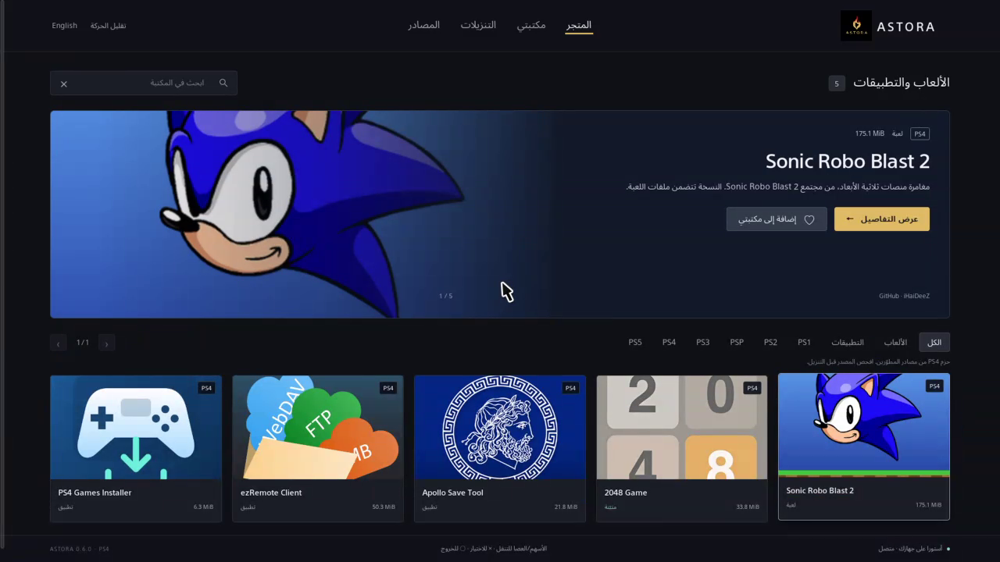

# ASTORA native PS4 test build

Version **0.6.0-alpha.1**, title ID **ASTR00001**, package version **00.70**.
This is an independent process with its own console loopback server, browser dialog,
HTTPS client and BGFT adapter. It does not load NovaStore, DiPlay, their plugins,
or a computer-hosted server. **Actual PS4 testing verified opening the interface,
directional selection, confirm-button activation, native HTTPS package inspection,
the complete 2048 download, installed-title confirmation, game launch and tile
movement on PS4 13.52. Its own Quit action crashed with CE-34878-0, cause unconfirmed.
Literal PC-off operation and broader compatibility remain unverified.**

The initial package is 6,619,136 bytes. The bundled catalog links three developer
utilities, 2048 and Sonic Robo Blast 2; game binaries are not bundled. Files download
from their developers to the console. No paid hosting or service was configured.

## Storefront update

The native interface now uses horizontal Store / My library / Transfers / Sources
navigation, authentic project covers, an image-led feature panel, a complete game
details overlay and saved favorites. Dark mode only. Directional focus and pointer
movement update the selected cover and game description. No abstract floating
objects, geometric ornaments, background videos or fabricated ratings are used.
Store shelves mount five cards at 1080p, four at 720p, or two on narrow viewports;
My library uses up to two rows. Motion is limited to short focus and opacity
transitions; reduced motion disables them.



The first 0.6.0 build opened on PS4 13.52, displaying all five bundled entries and
the new source-management screen. USB import initially found no files because
process filesystem access had not been prepared. The follow-up build initializes
the existing credential lifecycle before USB reads; its device acceptance and
SRB2 download/play test await reconnection to the test console. Host USB tests
pass, but do not establish device behavior. See the verification record.

Sources accepts ASTORA and FPKGi JSON catalogs, stable-ID replacement, enable /
disable, URL refresh and removal. A single package can be inspected and added to
My additions without starting a download. USB JSON files go under
`ASTORA/catalogs/` on usb0 or usb1; use ASCII file names ending in `.json`.
The optional `catalogs/console-tools.json` links PS4 Cheats Manager and Apollo.
Catalogs and favorites are stored in the console browser's local storage.
Storage failures are reported rather than silently discarding a change.

Limits: 20 catalogs, 5,000 visible unique entries, 12 sources per entry, 2 MiB per
import. Only base PS4 packages install; PS3 and PS5 entries remain unsupported.
Images and packages retain their original authorship. Exact cover source URLs
and hashes are included in `ui/covers/sources.json` and attribution is included
under `notices/cover-art.txt`.

Details are populated before their overlay opens. Request errors stay visible,
closing the panel restores focus, and stale responses cannot replace a newer
panel. Closing the native browser dialog now requests a normal application exit
instead of leaving a running process with no interface. This fixes an identified
lifecycle gap. Device testing found that a zero browser-control mask disabled
input and the zero package ATTRIBUTE made Cross cancel the browser. The custom
browser now enables its controls, and ATTRIBUTE bit 5 follows the system confirm
button. The directional-input bridge routes confirm clicks to the focused control;
stick movement restores pointer targeting. Circle exits the native dialog, so the
footer labels it as Exit; the panel's close button returns to the library.

On PS4 13.52, 0.4.5 opened the 2048 details, selected Check source with the D-pad,
and activated it with Cross while the pointer remained elsewhere. Native HTTPS
returned the expected SKID02048 header and 33.8 MiB size. Installation then failed
loading AppInstUtil. One first launch after replacement showed CE-34878-0; the next
launch succeeded. This intermittent startup issue remains unresolved.

The HTTP adapter uses a supported resolver retry count and a non-null empty proxy
host. Installer modules load through Sysmodule before symbol resolution. Build
0.4.6 tested a ShellCore SELF identity suggested by
[flatz's AppInstUtil documentation](https://flatz.github.io/), but it did not
resolve this console's module-load failure. Version 0.4.7 restored the original
SELF identity and loaded SysCore/NpCommon successfully, but AppInstUtil still
failed with the same codes. Version 0.4.8 separates optional AppInstUtil
confirmation from BGFT download submission. BGFT installed-title conflicts are
still rejected without retrying, uninstalling or enabling overwrite. If the
confirmation service is absent, a finished transfer remains unconfirmed and the
UI directs the user to PS4 Notifications; it is never labeled installed.
See the [verification record](../docs/verification.md) for device results.
Version 0.4.9 adds process credential setup through external libjbc before installer initialization, with checked results and restoration on normal exit. This uses the existing homebrew kernel interface; it does not activate accounts or change persistent system files. The build fetches a checksum-pinned dependency into ignored build output. On PS4 13.52, this resolved BGFT initialization. Registration then rejected GitHub’s redirected asset URL with `0x80990033` (unsupported URL extension).

Build 0.4.10 publishes a single-piece BGFT reference document on a separate console-only loopback listener. It uses the package-header digest and inspected size, preserves the signed HTTPS source unchanged, and gives BGFT a `.json` URL. The file itself still downloads directly from its source. The manifest is kept in memory until ASTORA exits; no computer relay or paid service is used. A random capability route protects each document. On PS4 13.52 this completed the 33.8 MiB 2048 transfer and installation. The installed record persisted after ASTORA reopened; both normal exits logged successful credential restoration. Arabic/English and dark/sand switching were visually verified on the console.

## Build

Requirements: OpenOrbis 0.5.4, clang-18, ld.lld-18, make, Python3 and Pillow.
Use your own toolchain outside this repository. No proprietary SDK is included.

```sh
export OO_PS4_TOOLCHAIN=/absolute/path/to/OpenOrbis/PS4Toolchain
cd native
make package
```

The old bundled Linux PkgTool.Core needs an older OpenSSL runtime. On a newer WSL
distribution, `make prepare` still produces the ELF, SELF, assets, SFO and GP4;
use a compatible Windows LibOrbisPkg packager for final assembly:

```powershell
./native/build-windows.ps1 -Toolchain C:/tools/OpenOrbis/PS4Toolchain -PkgTool C:/tools/PkgTool.exe
```

`build-windows.ps1` uses WSL Ubuntu for compilation and the specified Windows
packager. It never changes global TLS/SSL settings. The Linux SFO helper runs
with .NET invariant globalization for its own process only. Build output stays
under `native/build/`, ignored by Git. `prepare-package.py` exports a 512×512
console icon while preserving the project-supplied original logo unchanged.

## UI preview and checks

```sh
node native/preview.mjs
# http://127.0.0.1:4319/ — browser-only preview, no console connection
node --test native/tests/ui-model.test.mjs native/tests/ui-input.test.mjs
python3 native/tests/test-server.py
python3 native/tests/test-manifest.py
clang-18 -std=c11 -Wall -Wextra -Werror -fsanitize=undefined -fsanitize-trap=all -Inative/build/libjbc native/tests/privileges-test.c -o /tmp/astora-privileges-test
/tmp/astora-privileges-test
clang-18 -std=c11 -Wall -Wextra -Werror -fsanitize=undefined -fsanitize-trap=all native/tests/backend-test.c -o /tmp/astora-backend-test
/tmp/astora-backend-test
clang-18 -std=c11 -Wall -Wextra -Werror -I native/tests native/tests/browser-lifecycle.c -o /tmp/astora-browser-test
/tmp/astora-browser-test
```

The host HTTP tests run the actual server with an explicit mock backend. Backend
tests supply native API doubles. They are not device tests. Browser rendering,
Arabic shaping and controller behavior need separate PS4 checks.

For local developer pairing only, a manually created
`/data/ASTORA/.request-remote-play-info` marker triggers a one-time read of the
current user's numeric account ID into `/data/ASTORA/remote-play-info.json`.
The package never creates this marker itself. The marker is consumed immediately;
the diagnostic does not activate accounts, read passwords, or transmit the ID.
Keep this output private and remove it after the requested local pairing setup.

## Console installation and acceptance

1. Activate the user's existing GoldHEN session. Copy the generated PKG to USB.
2. GoldHEN → Debug Settings → Package Installer → ASTORA package.
3. Open ASTORA. Confirm the flame icon, Arabic UI, language and theme buttons,
   and controller navigation. Do not infer success from the app's launch result.
4. `/data/ASTORA/native-status.log` should record boot, native backend, listener,
   browser, splash and actual UI requests. UI requests prove a request, not rendering.
5. Open **2048 Game**, choose **Check source**, then **Download and install**.
   Confirm real progress, installation, game launch and controller operation.
6. Repeat using a different not-already-installed developer package with the
   computer powered off. Record firmware, package/version and observed outcome.

ASTORA creates only its own data directory and its own installation tasks.
It does not automatically uninstall, overwrite other titles or cancel other apps'
tasks. Closing ASTORA does not intentionally cancel accepted BGFT tasks. Progress
after reopening depends on the system still retaining the task record.

## Current limits

- Reviewed GitHub HTTPS hosts only; not arbitrary share links or link shorteners.
- Base PS4 packages only. Updates, DLC and raw ISO/BIN/PBP/ZIP extraction are not implemented.
- PS1/PS2/PSP metadata does not provide an emulator. Only already prepared PS4
  wrapper packages use this installer. None is advertised as gameplay-tested.
- PS3/PS5 local installation is rejected. The PS4 edition of a cross-generation
  game is a separate package.
- Native checks cover the 8KiB header, content/title/type/size and TLS path.
  The native BGFT path **does not compute a full-file SHA-256**. Desktop hash
  validation must not be attributed to the native build.
- Registration is not installation. Completion requires actual BGFT progress
  and installed-title confirmation. Missing task state is shown as unknown.
- HTTP requests have a 30-second budget; firmware BGFT IPC has no documented
  cancellation timeout. A native service failure can still require closing the app.
- Sources and their servers can change. Reachability does not prove compatibility.
- Keep ASTORA open during a transfer in this test build. Reference documents are
  process-local, and upstream signed URLs expire. Resume after app closure,
  suspension or power interruption has not been verified.

Original application code is MIT. Packaged OpenOrbis runtime components retain
their own licenses; see [notices](notices/README.txt). Native binary publication
must include the corresponding dependency source/build material, not only the
ASTORA source tree. This local test package has not been published as a verified release.

Vendored parser: [cJSON v1.7.19](https://github.com/DaveGamble/cJSON/tree/v1.7.19), unmodified source with its MIT notice. The configured nesting limit is 32.

External build dependency: [bucanero/ps4-libjbc](https://github.com/bucanero/ps4-libjbc), revision `835fe016ff0ae5dd89b9249f39cc0fe093fd07dd`, derived from sleirsgoevy. `fetch-libjbc.py` verifies its archive SHA-256 and places only selected source files in ignored build output. This dependency is not relicensed under ASTORA’s MIT license. Its redistribution terms must be established before publishing a combined binary.
